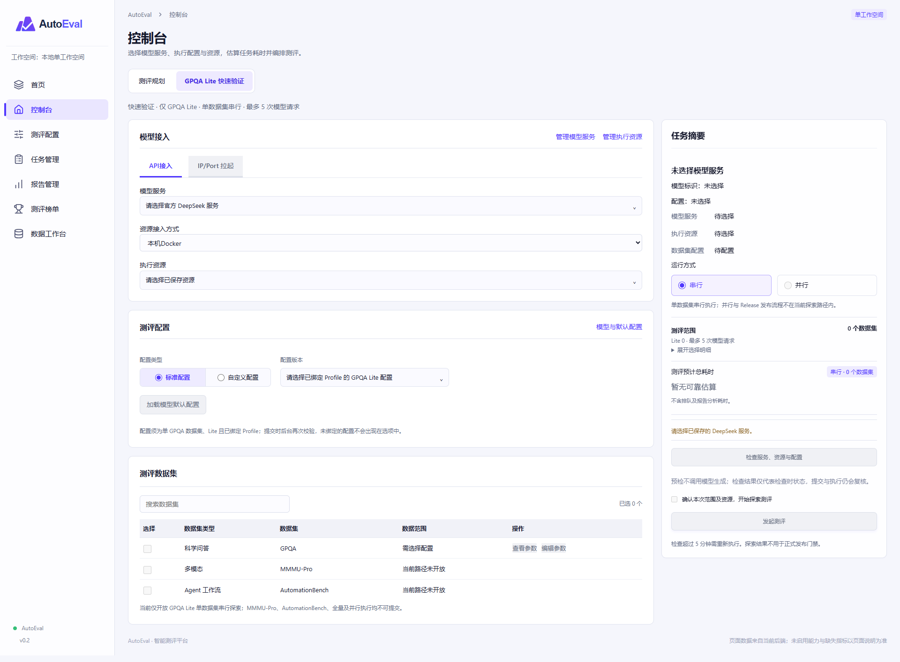
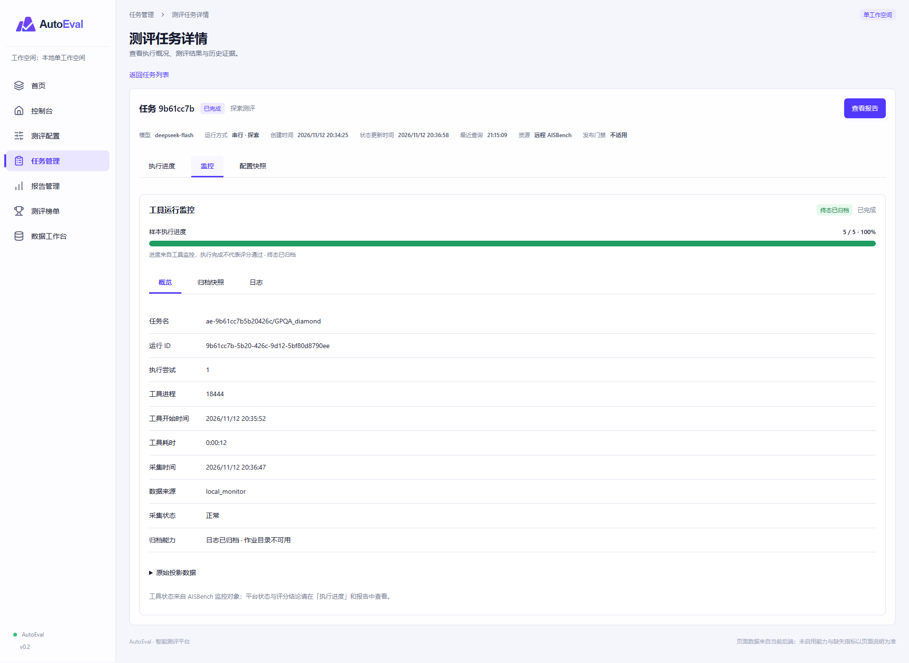

# AutoEval Demo

<p align="center">
  
</p>

AutoEval 是单团队、单工作空间的模型测评平台，采用 React、TypeScript、Vite、FastAPI、Temporal、PostgreSQL 和 S3 兼容对象存储。极光仅为独立资源提供方，不约束平台技术栈。

## 当前开发状态

更新日期：2026-11-13。当前为受控开发环境，正式身份接入、Release门禁及生产验收尚未完成。

- **真实GPQA Lite闭环**：网页提交 → Outbox/Temporal → SSH/容器内AISBench → SFTP与对象归档 → Case → 报告 → 评审入榜已验证。最新5样本任务准确率 **80%（4/5）**，恰好5次调用，证据及清理状态已核对；不代表198样本全量效果。
- **输出预算**：远程AISBench监控路径显式支持每条最多 **2048输出tokens**；其他兼容探索入口仍限64。每次最多5个样本、串行、无预热、不自动重测；旧快照继续按原冻结预算执行。
- **执行进度**：提交与排队、环境准备、测评执行、结果归档、任务完成五阶段；等待时显示当前阶段动画与每秒更新的任务耗时，终态固定总耗时。样本计数未知时不虚构百分比。
- **Case与报告**：保留每次尝试、工具时间与Token；新CLI路径从经校验的原生预测文件关联模型输入/响应，保留原证据哈希。执行成功、评分和证据完整性分别展示；两份更早的缺失证据报告仍仅保留历史索引。
- **已评审榜单**：同模型ID、同配置及可比条件默认取最优，同分取最近；可切换全部成绩。不同样本、工具版本与参数分开。已按用户要求撤下两组旧64-token成绩，当前该模型GPQA榜单保留80%记录；原报告与审计不删除。官方公开成绩保留来源，不代表平台复现。
- **标准仓与适配器**：标准输入版本化、来源与锁定参数、配置编译、统一输出及证据归档已接入；只有已验证的GPQA路径开放真实执行，MMMU-Pro、DeepSWE和Harbor真实执行分别验收。
- **规划与通用编排**：固定Planner版本，支持资源预检、显式吞吐探测、耗时规划、不可变执行计划与三数据集编排代码；真实三数据集闭环尚未验收。控制台通过“测评规划 / GPQA Lite快速验证”切换，探测和测评需分别确认预算。

| 组件 | 启动与边界 |
| --- | --- |
| API / Dispatcher / Workflow与活动Worker | 仅启动API不会执行测评；按下面步骤及后台说明启动对应角色 |
| 监控Worker | `uv run python -m autoeval.worker monitored`；固定AISBench `698ff2d`、Adaptor `955089a`及补丁摘要；仅容器内127.0.0.1监听 |
| 规划Worker / 通用执行Worker | `uv run python -m autoeval.planning_worker` / `uv run python -m autoeval.worker planning-execution`；环境需固定Planner与工具版本 |
| 数据库 / 对象存储 | 本轮已提交迁移至 `0028_config_no_approval`，部署时执行 `alembic upgrade head`；证据使用持久化S3，Temporal与业务数据库隔离 |
| 分析 / 性能 / 极光 | 分析需独立目标和预算；性能成绩及极光真实接入未验收，不能以Token或总耗时替代性能成绩 |

接入、验证与恢复记录：

- [阶段进度与耗时最新录屏记录](./docs/stage-elapsed-recording-2026-11-12.md)、[2048-token复测](./docs/gpqa-output2048-validation-2026-11-12.md)
- [Case原文关联及历史证据](./docs/monitor-case-evidence-fix-2026-11-12.md)、[榜单最优成绩规则](./docs/leaderboard-best-selection.md)
- [标准仓输入](./docs/standard-inputs.md)、[统一输出接入](./docs/unified-output-integration.md)、[任务规划与编排](./docs/task-planning.md)
- [无模型归档验证](./docs/platform-fixture-validation-2026-11-12.md)、[持久化存储与恢复](./docs/development-recovery.md)

## 2026-11-13 配置与规划更新

- **直接测评为默认路径**：不启动探测、不选择吞吐曲线、不生成估时结果，也可在参数、服务及执行资源预检通过并确认范围后提交。后台冻结当前参数与样本范围，不自动修改并发、不调用 Planner 估算；无依据时显示“暂无可靠估算”。优化编排与采纳方案都是可选操作。
- **标准仓列表**：支持版本、模型、数据集组合筛选，后端筛选后分页；默认显示最近导入记录所属的完整提交，可切换全部或历史版本。模型身份忽略大小写匹配，歧义需显式选择；官方目录可登记模型身份，但不自动建立 API 服务。
- **配置边界**：标准仓启动配置以 `benchmark_config.json` 为准，`standard_config.json` 提供锁定字段；当前页面不补造缺少的启动文件。标准配置完整性与服务、执行环境分别检查，旧快照保留追溯。配置审批已取消，结果入榜评审保持独立。
- **服务器容器 Planner**：客户 SSH 路径显式绑定容器与镜像 ID，在独立内容哈希目录部署固定 Planner `0ee9abf49a57c5accc62df8900693cdcea88ea9a`；计算和探测在容器内运行，平台进程只协调状态及归档，不回退到 SSH 宿主机。
- **探测进度**：新任务支持阶段、真实完成档位、当前并发、累计耗时、任务 ID 及过期提示。采集异常不重发模型请求，历史未采集数据不补造。
- **真实验收**：DeepSeek 容器探测的并发 1/2/4/8 档均返回有效数据，错误率均为0；对象哈希读回及清理完成。该验证不等同于时长预测误差、全量测评或三基准闭环验收。见[真实探测记录](docs/planner-real-acceptance-2026-11-13.md)。

在 `backend/.env` 中将 `AE_PLANNING_CONTAINER_CONFIG` 指向受保护 JSON，格式为资源 UUID 到 `{ "container_id": "完整容器ID", "image_id": "完整镜像ID" }` 的映射。文件不提交；缺少绑定会阻断，不猜测容器。

```powershell
# 在 backend/ 目录，分别启动协调与执行进程
uv run python -m autoeval.planning_worker
uv run python -m autoeval.worker planning-execution
```

规划协调进程默认只处理 `preflight,plan`，**不会消费排队中的探测**。真实探测需先核对历史待办和预算，再显式设置 `AE_PLANNING_JOB_KINDS=preflight,plan,probe`；启用后会消费待办，不能盲目开启。修改配置或升级代码后需重新加载 API、规划协调及相关 Worker。无模型回归不会为展示进度发起付费调用。

本轮相关后端回归22项通过、2项跳过，浏览器模拟验证覆盖无吞吐曲线提交和2/4档进度；类型检查、构建及相关Ruff检查通过。真实吞吐探测与模拟界面验证分别记录，不作为预测准确性承诺。

## 配置与数据集目录更新

- 标准配置与自定义配置为同级入口。参数采用中文名称、原始键名与 ⓘ 解释，使用紧凑分组布局；原文和来源信息折叠查看。
- 自定义配置可从同一基准的标准模板补齐 `tool/subcommand/params`，完整嵌套参数随新版本保存。旧版参数保持兼容；完整适配器配置尚未开放探索执行，后端明确阻断。
- 模型列表纳入标准仓来源模型，仅精确且唯一匹配时合并。数据集列表、添加数据集及模板选择共用已登记的 AISBench 标准目录，不将参考成绩自动视为可执行数据集。
- `AutomationBench` 已登记为待核验身份，不等同 DeepSWE；工具支持、数据版本和样本清单未验证，不进入可添加的 AISBench 目录。其他环境可执行 `uv run python -m autoeval.register_automationbench` 幂等登记。
- GitHub 同步使用系统可信 CA，保留 HTTPS 校验；网络请求与内容校验失败分别提示。标准仓与自定义配置均无需配置审批；同步不会启动测评。

## 本机启动

工作目录采用以下结构：

```text
frontend/   React 页面、组件与 API 客户端
backend/    FastAPI、Worker、数据库迁移、工具适配与测试
deploy/    开发容器与 SSH 模拟器配置
docs/      开发计划、接入说明、验收与恢复记录
```

### 1. 基础服务与持久化存储

数据库、Temporal、执行器及已登记资源须先就绪。业务证据使用[持久化存储与恢复指南](./docs/development-recovery.md)，不能使用重启即丢失状态的 Moto 模拟器。

在仓库根目录执行，先在受保护配置中设置一致的 S3 凭据：

```powershell
docker volume create autoeval-evidence-persistent
docker compose --env-file backend/.env -f deploy/compose.storage-durable.yaml up -d
```

开发存储使用固定摘要的 GHCR 社区 MinIO 备份镜像，主机端点为 `http://127.0.0.1:9002`，独立持久卷为 `autoeval-evidence-persistent`。来源、版本及回退步骤见恢复指南；不视为官方签名或生产安全验收。原基础 Compose 的 Moto 仅供协议测试。

### 2. API 与后台进程

```powershell
cd backend
uv sync --frozen --python 3.12
# 首次配置时从.env.example建立.env；已有配置不要覆盖。
# 设置数据库、Temporal及AE_S3_ENDPOINT=http://127.0.0.1:9002。
uv run alembic upgrade head
uv run python -m autoeval.bootstrap storage
uv run uvicorn autoeval.api:app --host 127.0.0.1 --port 8000
```

独立终端均在 backend 目录运行：

```powershell
uv run python -m autoeval.dispatcher
uv run python -m autoeval.worker workflow
uv run python -m autoeval.worker io
uv run python -m autoeval.worker gpqa
uv run python -m autoeval.reconciler
```

每条常驻命令使用独立终端。分析 Worker 仅在分析目标、资源及预算明确后开启。更多说明见[后端 README](./backend/README.md)。

### 3. 前端

准备 Node.js 22 或更高版本：

```powershell
cd frontend
npm ci
npm run dev
```

前端 `http://127.0.0.1:5173`，通过 Vite 代理访问 API；API 文档 `http://127.0.0.1:8000/docs`。`/health/live` 检查存活，`/health/ready` 检查数据库、Temporal 和对象存储。

## 页面与业务流程

- 控制台保留模型接入、配置、数据集和右侧摘要；管理能力通过表单旁抽屉进入。提交前检查模型列表、资源及配置，确认范围后提交；预检不发送生成请求。
- 已保存服务可加载模型默认配置，保存配置生成新版本。任务与报告沿用“总览 → 数据集详情 → Case / 证据”路径。
- `#run/<UUID>` 可直达任务，刷新恢复上下文；任务冻结参数与历史记录不随当前默认配置更新。
- 报告可回溯来源任务、case 的每次尝试与证据。失败历史不因重试成功而覆盖。
- `validity` 表示历史执行完整性，`evidence_status` 表示当前报告证据状态。缺失、不可用或校验失败的证据不作为有效成绩，不计算基准差值，不参与榜单；不补零或伪造成绩。
- 报告总览增加准确率与基线对比图、百分点差异及基线版本；缺失证据或不可比时不绘制虚假数值。性能区域暂显示未采集说明，尚无吞吐量、延迟及性能基线。
- 模型、服务、执行资源与数据集选择支持搜索；模型选择与管理统一使用 ModelScope 格式的 `组织/模型名`，映射中另保留 Hugging Face 标识，不等同于模型服务的 API 模型名。部分自动化测试模型在前端选择和列表中隐藏，底层历史记录仍保留。
- 榜单支持排行榜 / 图表切换、数据集、指标、来源筛选和模型搜索；前端可将同一数据集与指标的已评审平台及官方成绩合并作参考展示，以颜色和逐条条件区分。Lite、全量、思考模式或测试方法不一致时，参考顺序不代表严格同条件排名。展示来源及可用元数据，缺失发布时间、评测时间或参数量保持空缺，不使用抓取时间代替评测时间。来源资料见 [官方数据快照](./docs/official-data/2026-11-11/)。
- 开发模式新增 `#data-workbench` 数据工作台：报告提名、评审批准 / 驳回、撤回与修改、人工及官方来源录入、JSON 批量导入。工作台另提供模型列表与数据集列表，用于汇总已登记及录入的数据。榜单支持非报告成绩；来源和条件随记录保留，原自动报告排名作为未人工评审的候选成绩保留。
- Docker 诊断集中至数据工作台。生产前端不包含工作台和诊断控件；维护 API 同样限制在 development/test。当前本地操作员自审不等同于生产审批或正式门禁。
- 空输出、截断等诊断保持原生评分规则，不能由平台擅自改判。缺测、执行失败、评分失败和不可比须分别展示。

## 验证状态

2026-11-11 收口修复后全量回归 **228 项通过，无跳过**，用时342.75秒；TypeScript、Vite 构建与 Ruff 通过。该次回归对应迁移 `0021`；当前新增榜单维护迁移 `0022_leaderboard_curation`。84个现存对象完成迁移、逐对象校验及容器重启后读回。

随后页面与数据工作台增量验证：TypeScript、Vite 和修改文件 Ruff 通过；新增工作台与已有恢复测试合计 **17 项通过**，其中维护事务使用真实 PostgreSQL。浏览器检查原页面路径、报告图表边界和工作台页签；预检及图表数值场景使用模拟响应，不代替真实测评验收。本轮未重跑上述 228 项全量回归。

两份历史真实报告的原始证据没有备份，无法恢复；当前保留历史索引并明确隔离。本轮真实报告页面验证缺失保护分支，不能将回归通过解释为历史数据恢复、新真实测评或生产验收。模型边界替身测试不产生真实榜单成绩。

```powershell
# frontend目录
npm run typecheck
npm run build
# backend目录
uv run ruff check .
uv run pytest -q
```

本次（2026-11-12）在 `AE_INFRA_TEST=1` 下后端269项通过、83项跳过；监控浏览器回归8项、规划浏览器回归1项通过；Ruff、TypeScript和前端构建通过。跳过项不代表验收通过，也未通过测试新增真实模型调用。默认 pytest 会跳过依赖外部环境的专项，不能代替启用联调开关的验证。详见[收口验证记录](./docs/validation-2026-11-11.md)、[开发计划](./docs/backend-development-plan.md)及[恢复指南](./docs/development-recovery.md)。

依赖、构建产物、凭据、.env、本地备份和分享包不提交 Git。密码、私钥和 API Key 仅由后台受保护配置管理，不进入前端存储、运行快照或普通日志。

## 当前页面预览

以下截图于 2026-11-12 从当前本机开发环境重新采集，视口为 1920 × 1400，长页面使用整页截图。截图包含本机配置与测试记录，不代表生产验收；未创建测评、调用模型或修改榜单数据。

任务和报告详情展示本次真实GPQA Lite 80%报告、阶段进度与终态耗时；Case原文已关联原生归档。缺失或未采集指标不补零。榜单中的官方来源成绩来自已录入的外部快照，不代表 AutoEval 已复现；条件不同的成绩仅作参考。截图不是正确性验收证据。

### 首页

> 当前开放 GPQA Lite 探索；性能测评仍未接入。


### 控制台


### GPQA Lite快速验证



### 测评配置


### 自定义配置维护


### 任务管理


### 任务总览


### 工具监控与归档



### Case执行证据


### 报告管理


### 报告总览


### 数据集报告详情


### 测评榜单


### 数据工作台


## 开发数据工作台

开发环境新增“数据工作台”菜单，支持报告提名与评审、外部榜单成绩维护、官方 JSON 快照导入和环境诊断。榜单不要求全部来源于报告；后端保留来源与条件分组，前端支持跨组参考展示，不能将参考顺序用于正式门禁。使用前应用数据库迁移至 `0022_leaderboard_curation`，详见 [使用与接口说明](./docs/data-workbench.md)。支持官方来源快照导入及仓库中的定向导入脚本；尚未提供通用官网自动同步或定时调度。页面导入先进入待评审；`backend/scripts/` 下部分定向脚本会调用批准接口，运行前须审阅来源、目标本机 API 及批准逻辑，不能按只读采集脚本使用。

## 浏览器回归检查

临时浏览器脚本已整理至 `backend/tests/browser_checks/`，复用 Playwright，默认不执行。设置 `AE_BROWSER_TEST=1` 运行模拟预检和图表检查；另设 `AE_BROWSER_LIVE_TEST=1` 检查本机任务、报告及工作台只读导航。浏览器可通过 `AE_CHROME_PATH` 配置，截图输出到已忽略的 `.screenshots/browser-checks/`。真实写请求与外部请求会被拦截。运行步骤及验收边界见 [浏览器测试说明](./backend/tests/browser_checks/README.md)。

标准输入详情现支持自动补全候选配置、查看来源与差异，确认后保存不可变编译快照；缺少环境信息仍需补充，不自动批准或开放执行。见 [标准输入说明](docs/standard-inputs.md#自动补全启动配置)。

内网试用环境的服务器部署、迁移及无模型验收见[部署验收记录](docs/intranet-deployment-validation-2026-11-13.md)，启停、备份与管理员待办见[发布操作说明](deploy/intranet/README.md)。外部访问与正式切换尚待管理员放行和最终核对。
