# AutoEval Demo

AISBench 运行监控接入包含 `0026_run_monitor`、受控快照/日志接口和任务详情实时区域。仅使用 `backend/tool-locks/aisbench-monitor.json` 固定的独立部署副本，经 `AE_AISBENCH_MONITOR_CONFIG` 指向受保护配置，并启动 `uv run python -m autoeval.worker monitored`（compose 的 `workers` profile 亦包含该角色）。监控只绑定容器内 `127.0.0.1`，不发布宿主端口；单任务最多 5 次模型调用、每条最多 64 输出 tokens，工具与平台均不自动重试生成。Harbor 目前仅完成字段契约，真实测评尚未验收。历史录屏不代表当前修改后的验证结果。

<p align="center">
  
</p>

AutoEval 是单团队、单工作空间的测评平台。当前实现以 GPQA Lite 探索测评为主线：模型服务 → 配置版本与确定性清单 → Docker/客户 SSH 执行 → case 历史 → 报告、分析与内部榜单。极光是独立资源提供方，不约束本平台技术栈。

前端采用 React、TypeScript、Vite；后端采用 FastAPI、Temporal、PostgreSQL 和 S3 兼容对象存储。当前为受控开发环境，正式 Release 和生产验收尚未完成。

## 当前开发状态

人工产物归档闭环已通过真实前端、Outbox、Temporal、SSH/SFTP、开发S3、case与报告验证。入口为数据工作台的“环境诊断 → 平台归档流程验证”，不会调用模型。当前迁移至0025，需运行独立fixture Worker；[验证记录及未覆盖范围](./docs/platform-fixture-validation-2026-11-12.md)。真实远程测评执行仍未验收。

新版标准输入与统一输出已增加离线契约解析、证据归档、case 元数据和 token 覆盖展示，需迁移至 `0024_unified_outputs` 并重启 API/Result Worker。远程适配器工作流与真实环境联调仍未开放；详见[接入状态及验证边界](./docs/unified-output-integration.md)。

更新日期：2026-11-12。

新增[标准仓输入接入](./docs/standard-inputs.md)：开发环境“数据工作台 → 标准仓输入”支持固定提交同步、离线包导入、原文与差异预览、模型映射及适配器配置编译。迁移至 `0023_standard_inputs` 后重启 API。当前仅对接输入，未接入适配器输出及测评执行；同步不自动批准配置、基线或榜单。

| 模块 | 已实现与验证 | 主要剩余边界 |
| --- | --- | --- |
| 模型与配置 | 模型/端点登记、默认配置、版本保存、Profile 与 Full/Lite 清单绑定、分页 | 正式批准输入与其他工具流程 |
| 资源与执行 | 本机 Docker、SSH/SFTP、批准指纹、资源工具版本固定、Temporal/Outbox、取消及查证恢复 | 客户生产环境验收；极光仅保留适配契约 |
| 历史与报告 | 每次 case 尝试、只读快照、原始证据校验、完整/部分/失败摘要、基准比较 | 两份历史真实报告原文已丢失且无法恢复，索引保留并隔离 |
| 分析与榜单 | 独立分析与重试；报告提名评审、外部及官方成绩录入、按来源与条件分组、历史审计 | 真实分析需独立目标、资源及预算；正式发布门禁未实现 |
| 工具适配 | GPQA Lite 探索闭环；MMMU-Pro 原生加载/评分及工具层桥接已有实现 | MMMU-Pro 平台闭环、AutomationBench；不以工具层测试替代端到端验收 |
| 开发运维 | 持久化 MinIO、逐对象校验迁移、容器重启读回、受保护备份、SSH 重启恢复 | 生产身份、部署、存储耐久性与运维验收 |

当前任务入口仅支持已校验的 GPQA 单数据集 Lite 探索路径，每次最多5个样本、每样本最多64输出 tokens；提交会调用真实模型，不会自动重测。自定义/Lite 不产生正式 Release 通过结论。性能测评未接入，不展示为真实性能结论。

## 配置与数据集目录更新

- 标准配置与自定义配置为同级入口。参数采用中文名称、原始键名与 ⓘ 解释，使用紧凑分组布局；原文和来源信息折叠查看。
- 自定义配置可从同一基准的标准模板补齐 `tool/subcommand/params`，完整嵌套参数随新版本保存。旧版参数保持兼容；完整适配器配置尚未开放探索执行，后端明确阻断。
- 模型列表纳入标准仓来源模型，仅精确且唯一匹配时合并。数据集列表、添加数据集及模板选择共用已登记的 AISBench 标准目录，不将参考成绩自动视为可执行数据集。
- `AutomationBench` 已登记为待核验身份，不等同 DeepSWE；工具支持、数据版本和样本清单未验证，不进入可添加的 AISBench 目录。其他环境可执行 `uv run python -m autoeval.register_automationbench` 幂等登记。
- GitHub 同步使用系统可信 CA，保留 HTTPS 校验；网络请求与内容校验失败分别提示。同步不会自动批准配置或启动测评。

## 本机启动

工作目录采用以下结构：

```text
frontend/   React 页面、组件与 API 客户端
backend/    FastAPI、Worker、数据库迁移、工具适配与测试
deploy/    开发容器与 SSH 模拟器配置
docs/      开发计划、接入说明、验收与恢复记录
```

### 1. 基础服务与持久化存储

数据库、Temporal、执行器及已登记资源须先就绪。业务证据使用[持久化存储与恢复指南](./docs/development-recovery.md)，不能使用重启即丢失状态的 Moto 模拟器。

在仓库根目录执行，先在受保护配置中设置一致的 S3 凭据：

```powershell
docker volume create autoeval-evidence-persistent
docker compose --env-file backend/.env -fdeploy/compose.storage-durable.yaml up -d
```

开发存储使用固定摘要的 GHCR 社区 MinIO 备份镜像，主机端点为 `http://127.0.0.1:9002`，独立持久卷为 `autoeval-evidence-persistent`。来源、版本及回退步骤见恢复指南；不视为官方签名或生产安全验收。原基础 Compose 的 Moto 仅供协议测试。

### 2. API 与后台进程

```powershell
cd backend
uv sync --frozen --python 3.12
# 首次配置时从.env.example建立.env；已有配置不要覆盖。
# 设置数据库、Temporal及AE_S3_ENDPOINT=http://127.0.0.1:9002。
uv run alembic upgrade head
uv run python -m autoeval.bootstrap storage
uv run uvicorn autoeval.api:app --host 127.0.0.1 --port 8000
```

独立终端均在 backend 目录运行：

```powershell
uv run python -m autoeval.dispatcher
uv run python -m autoeval.worker workflow
uv run python -m autoeval.worker io
uv run python -m autoeval.worker gpqa
uv run python -m autoeval.reconciler
```

每条常驻命令使用独立终端。分析 Worker 仅在分析目标、资源及预算明确后开启。更多说明见[后端 README](./backend/README.md)。

### 3. 前端

准备 Node.js 22 或更高版本：

```powershell
cd frontend
npm ci
npm run dev
```

前端 `http://127.0.0.1:5173`，通过 Vite 代理访问 API；API 文档 `http://127.0.0.1:8000/docs`。`/health/live` 检查存活，`/health/ready` 检查数据库、Temporal 和对象存储。

## 页面与业务流程

- 控制台保留模型接入、配置、数据集和右侧摘要；管理能力通过表单旁抽屉进入。提交前检查模型列表、资源及配置，确认范围后提交；预检不发送生成请求。
- 已保存服务可加载模型默认配置，保存配置生成新版本。任务与报告沿用“总览 → 数据集详情 → Case / 证据”路径。
- `#run/<UUID>` 可直达任务，刷新恢复上下文；任务冻结参数与历史记录不随当前默认配置更新。
- 报告可回溯来源任务、case 的每次尝试与证据。失败历史不因重试成功而覆盖。
- `validity` 表示历史执行完整性，`evidence_status` 表示当前报告证据状态。缺失、不可用或校验失败的证据不作为有效成绩，不计算基准差值，不参与榜单；不补零或伪造成绩。
- 报告总览增加准确率与基线对比图、百分点差异及基线版本；缺失证据或不可比时不绘制虚假数值。性能区域暂显示未采集说明，尚无吞吐量、延迟及性能基线。
- 模型、服务、执行资源与数据集选择支持搜索；模型选择与管理统一使用 ModelScope 格式的 `组织/模型名`，映射中另保留 Hugging Face 标识，不等同于模型服务的 API 模型名。部分自动化测试模型在前端选择和列表中隐藏，底层历史记录仍保留。
- 榜单支持排行榜 / 图表切换、数据集、指标、来源筛选和模型搜索；前端可将同一数据集与指标的已评审平台及官方成绩合并作参考展示，以颜色和逐条条件区分。Lite、全量、思考模式或测试方法不一致时，参考顺序不代表严格同条件排名。展示来源及可用元数据，缺失发布时间、评测时间或参数量保持空缺，不使用抓取时间代替评测时间。来源资料见 [官方数据快照](./docs/official-data/2026-11-11/)。
- 开发模式新增 `#data-workbench` 数据工作台：报告提名、评审批准 / 驳回、撤回与修改、人工及官方来源录入、JSON 批量导入。工作台另提供模型列表与数据集列表，用于汇总已登记及录入的数据。榜单支持非报告成绩；来源和条件随记录保留，原自动报告排名作为未人工评审的候选成绩保留。
- Docker 诊断集中至数据工作台。生产前端不包含工作台和诊断控件；维护 API 同样限制在 development/test。当前本地操作员自审不等同于生产审批或正式门禁。
- 空输出、截断等诊断保持原生评分规则，不能由平台擅自改判。缺测、执行失败、评分失败和不可比须分别展示。

## 验证状态

2026-11-11 收口修复后全量回归 **228 项通过，无跳过**，用时342.75秒；TypeScript、Vite 构建与 Ruff 通过。该次回归对应迁移 `0021`；当前新增榜单维护迁移 `0022_leaderboard_curation`。84个现存对象完成迁移、逐对象校验及容器重启后读回。

随后页面与数据工作台增量验证：TypeScript、Vite 和修改文件 Ruff 通过；新增工作台与已有恢复测试合计 **17 项通过**，其中维护事务使用真实 PostgreSQL。浏览器检查原页面路径、报告图表边界和工作台页签；预检及图表数值场景使用模拟响应，不代替真实测评验收。本轮未重跑上述 228 项全量回归。

两份历史真实报告的原始证据没有备份，无法恢复；当前保留历史索引并明确隔离。本轮真实报告页面验证缺失保护分支，不能将回归通过解释为历史数据恢复、新真实测评或生产验收。模型边界替身测试不产生真实榜单成绩。

```powershell
# frontend目录
npm run typecheck
npm run build
# backend目录
uv run ruff check .
uv run pytest -q
```

默认 pytest 会跳过依赖外部环境的专项，不能代替启用联调开关的全量验证。详见[收口验证记录](./docs/validation-2026-11-11.md)、[开发计划](./docs/backend-development-plan.md)及[恢复指南](./docs/development-recovery.md)。

依赖、构建产物、凭据、.env、本地备份和分享包不提交 Git。密码、私钥和 API Key 仅由后台受保护配置管理，不进入前端存储、运行快照或普通日志。

## 当前页面预览

以下截图于 2026-11-11 从当前本机开发环境重新采集，视口为 1920 × 1400，长页面使用整页截图。截图包含本机配置与测试记录，不代表生产验收；未创建测评、调用模型或修改榜单数据。

任务和报告详情展示现存历史记录；原始证据缺失提示及空指标如实保留。榜单中的官方来源成绩来自已录入的外部快照，不代表 AutoEval 已复现；条件不同的成绩仅作参考。截图不是正确性验收证据。

### 首页

> 当前开放 GPQA Lite 探索；性能测评仍未接入。

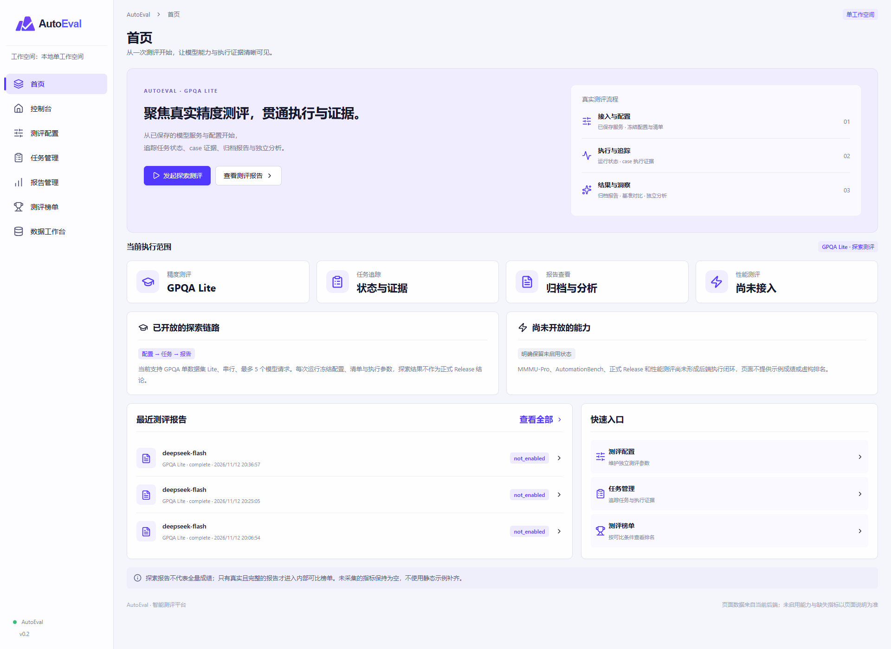

### 控制台

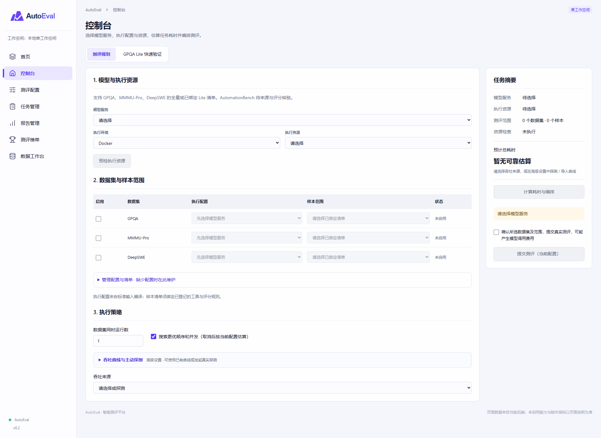

### 测评配置

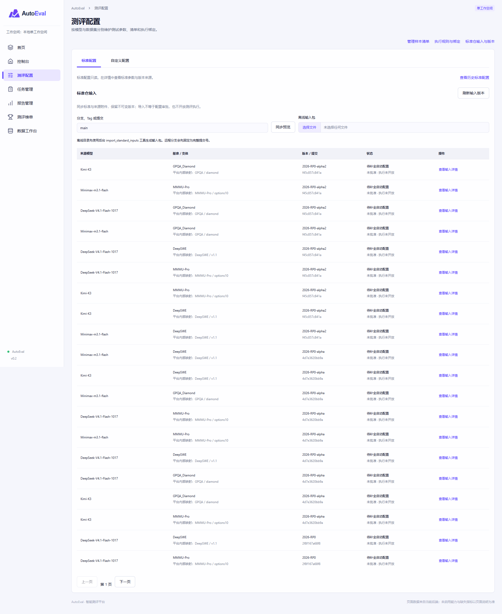

### 自定义配置维护

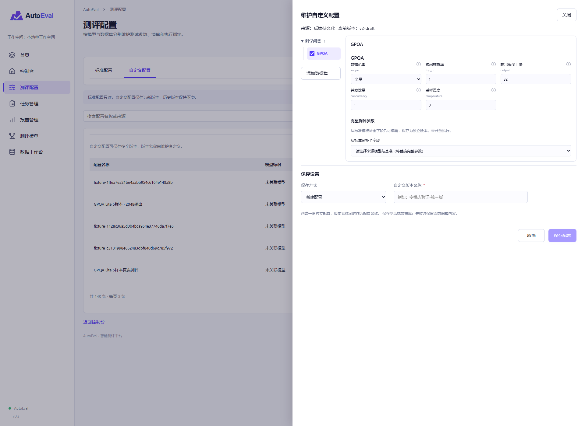

### 任务管理

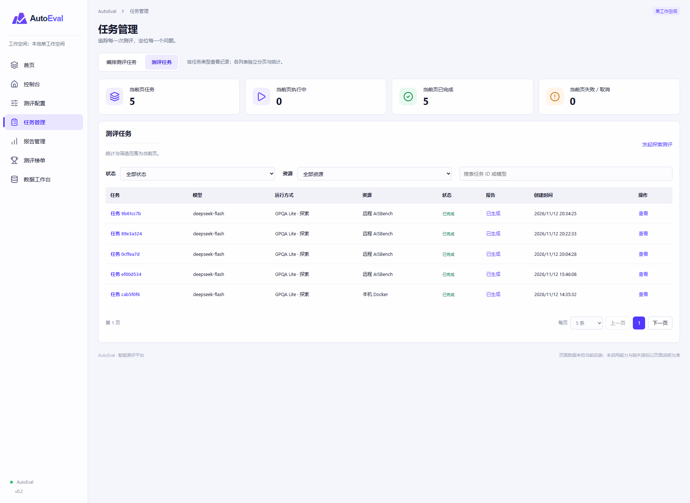

### 任务总览

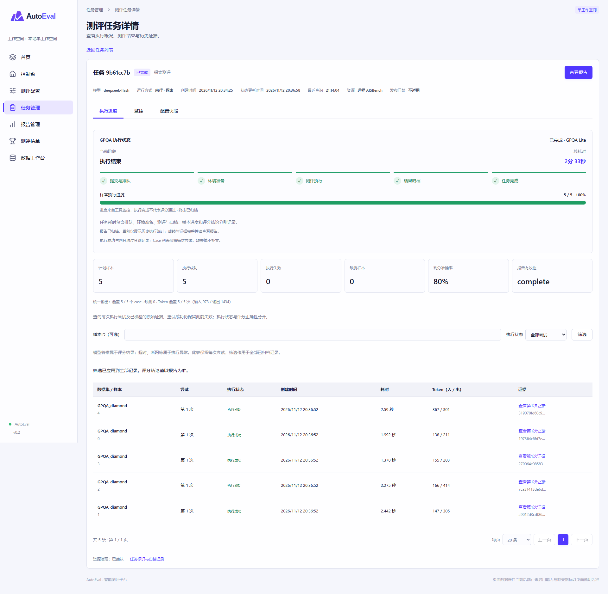

### 数据集执行详情

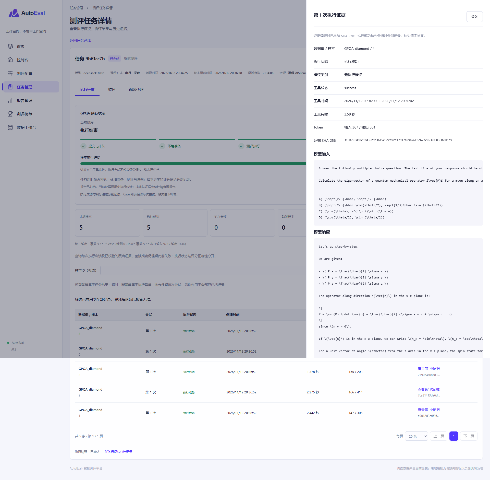

### 报告管理

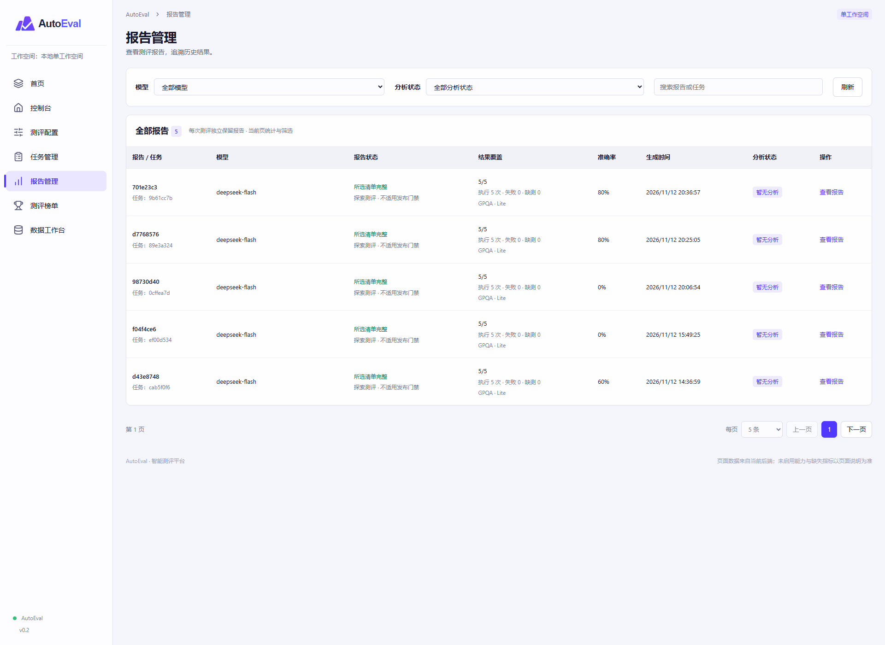

### 报告总览

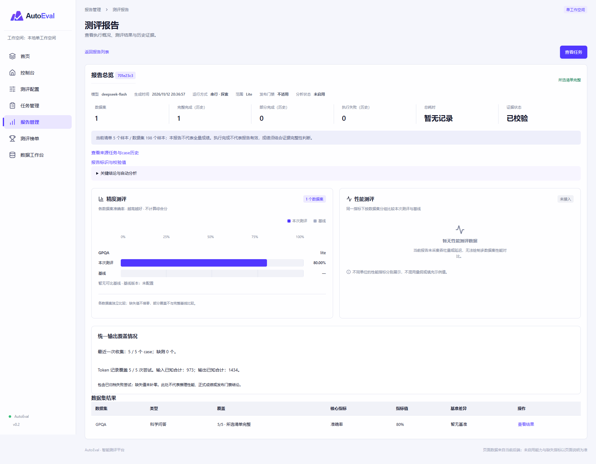

### 数据集报告详情

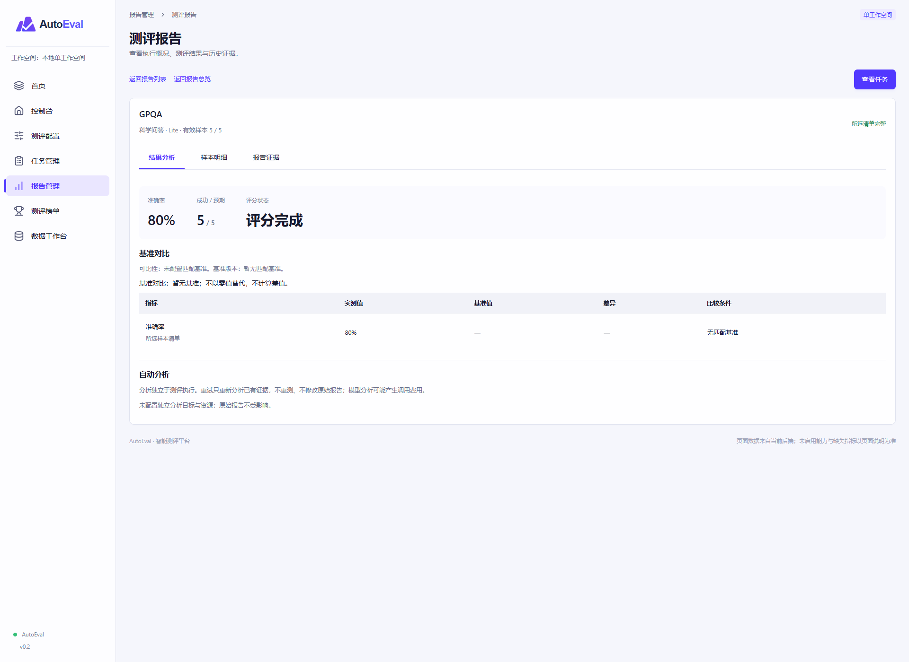

### 测评榜单

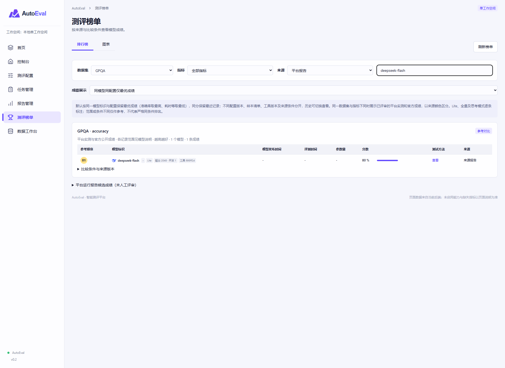

### 数据工作台

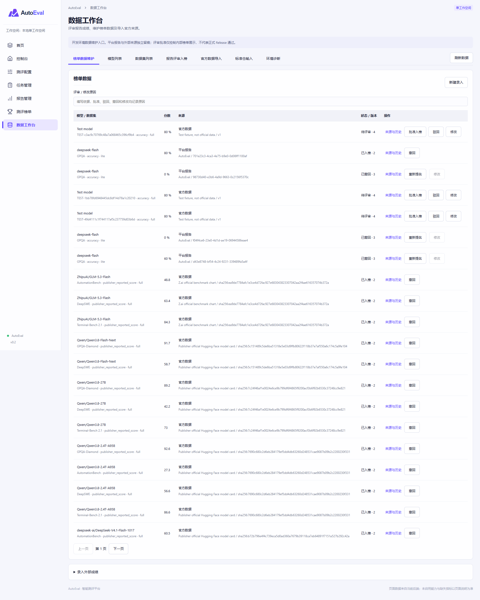

## 开发数据工作台

开发环境新增“数据工作台”菜单，支持报告提名与评审、外部榜单成绩维护、官方 JSON 快照导入和环境诊断。榜单不要求全部来源于报告；后端保留来源与条件分组，前端支持跨组参考展示，不能将参考顺序用于正式门禁。使用前应用数据库迁移至 `0022_leaderboard_curation`，详见 [使用与接口说明](./docs/data-workbench.md)。支持官方来源快照导入及仓库中的定向导入脚本；尚未提供通用官网自动同步或定时调度。页面导入先进入待评审；`backend/scripts/` 下部分定向脚本会调用批准接口，运行前须审阅来源、目标本机 API 及批准逻辑，不能按只读采集脚本使用。

## 浏览器回归检查

临时浏览器脚本已整理至 `backend/tests/browser_checks/`，复用 Playwright，默认不执行。设置 `AE_BROWSER_TEST=1` 运行模拟预检和图表检查；另设 `AE_BROWSER_LIVE_TEST=1` 检查本机任务、报告及工作台只读导航。浏览器可通过 `AE_CHROME_PATH` 配置，截图输出到已忽略的 `.screenshots/browser-checks/`。真实写请求与外部请求会被拦截。运行步骤及验收边界见 [浏览器测试说明](./backend/tests/browser_checks/README.md)。
